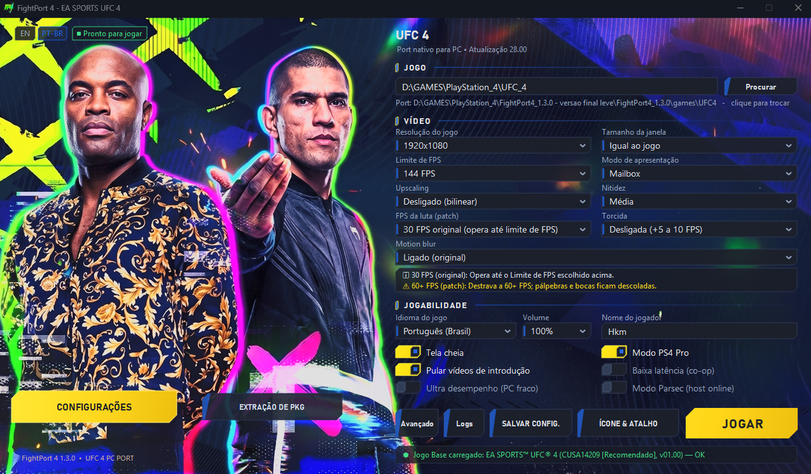
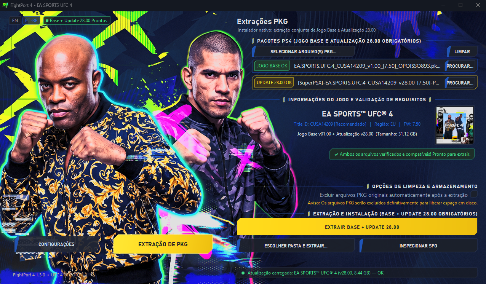
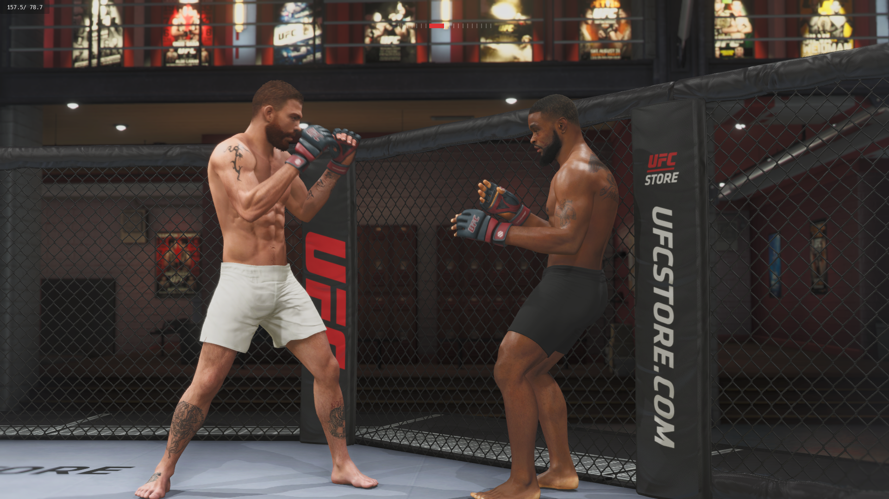

# FightPort 4 Native (1.3.0) — EA SPORTS UFC 4 Ultra-Lightweight PC Port

[-blue.svg)](#)

Dedicated ultra-lightweight launcher and single-click PKG extraction system for the native PC port of **EA SPORTS UFC 4** (PlayStation 4, `CUSA14209` & `CUSA14204`, update **28.00**).

> [!IMPORTANT]
> ### 💬 Comunidade Oficial no Discord & Suporte aos Jogos
> **Quer tirar dúvidas, acompanhar atualizações do port ou precisa de ajuda técnica para executar o jogo?**
>
> 🎮 **Servidor Oficial da HKM Team no Discord:**  
> 👉 [https://discord.gg/sRCaE57yn](https://discord.gg/sRCaE57yn)
>
> ⚠️ **AVISO OBRIGATÓRIO — ARQUIVOS DO JOGO NÃO INCLUSOS:**  
> **Ao baixar este inicializador (launcher), o jogo NÃO vem junto!**  
> Este projeto é de código aberto e **NÃO DISTRIBUI** jogos, ROMs, arquivos binários protegidos ou dados proprietários da Electronic Arts, UFC ou Sony. É **necessário possuir sua própria cópia legítima do EA SPORTS UFC 4** (Jogo Base v1.00 e Atualização Oficial 28.00 em formato `.pkg`).  
> Se tiver qualquer dúvida sobre como extrair seus pacotes ou rodar o executável no seu computador, nossa equipe e comunidade estão prontas para te ajudar no Discord!

---

## 🥊 Português (PT-BR)

### Visão Geral
O **FightPort 4 Native (1.3.0)** é a edição **ultra-leve** do FightPort, desenvolvida especificamente para garantir máxima fluidez, estabilidade e baixo consumo de memória em computadores modestos, notebooks e PCs de entrada ("PCs fracos").

Operando 100% de forma nativa sob uma camada de tradução direta em **Vulkan puro** — sem o peso de motores de upscaling (FSR, XeSS, DLSS), sem geração artificial de quadros (Frame Gen) e sem inferência neural de DLSS 5 —, esta versão ocupa apenas **~90 MB no disco** e entrega combate rápido, responsivo e sem travamentos.

---

### 🖥️ Telas de Configurações e Extração

O inicializador foi desenhado para ser direto, visual e intuitivo:

#### 1. Configurações de Vídeo e Áudio
Ajuste a resolução nativa de exibição, modo tela cheia, limite de quadros e volume com conversão estéreo 2.0 limpa:

#### 2. Extração Simplificada de PKG
Instale seu jogo em botão único: selecione o Jogo Base (`v1.00`) e a Atualização (`v28.00`) juntos e deixe o programa fazer a descompactação e mesclagem automatizada diretamente para a pasta do jogo.

---

### 🎨 Galeria com 19 Ícones Exclusivos

Crie seu atalho na Área de Trabalho com o rosto do seu lutador favorito:
- 9 grandes campeões com 2 fotos de alta definição cada (Poatan, Charles, Jones, Anderson, Khabib, Aldo, McGregor, GSP e Makhachev).
- Ícone clássico oficial da HKM Team.
- Atualização imediata no Desktop do Windows Explorer via `SHChangeNotify`.

---

### 🥊 Demonstração de Jogabilidade (Vulkan Nativo)

Ao dispensar camadas pesadas de pós-processamento e upscaling, o motor gráfico opera com física estável e resposta imediata aos comandos no controle:

---

### 📦 Como Instalar e Jogar

Você pode escolher entre duas formas de distribuição oficial:

#### Opção A: Pacote Portátil (.zip)
1. Baixe o pacote oficial na página de Releases:
   📦 **`FightPort4_Native_1.3.0.zip`** (apenas ~56 MB compactado).
2. Descompacte o arquivo `.zip` na pasta de sua escolha.
3. Abra o **`FightPort4.exe`**.

#### Opção B: Instalador Executável (.exe)
1. Baixe o assistente oficial:
   💿 **`FightPort4_Native_1.3.0_Setup.exe`** (apenas ~59 MB).
2. Siga as instruções do assistente para instalar e criar os atalhos automáticos no Desktop e no Menu Iniciar.
3. Abra direto pelo atalho da Área de Trabalho!

#### Extração dos Arquivos do Jogo (Primeira Vez)
1. Abra o **FightPort 4 Native** e acesse a aba **`EXTRAÇÃO DE PKG`**.
2. Clique no botão **`PROCURAR...`** e selecione o Jogo Base (v1.00) e a Atualização (v28.00) juntos.
3. Clique em **`Extrair para o Jogo`**.
4. Clique em **`JOGAR`** e bom combate!

---

### 🎮 Controles & Parsec
- Suporte Plug & Play a controles Xbox, PlayStation e genéricos via DirectInput/XInput.
- Suporte a 2 jogadores simultâneos no mesmo PC.
- Bloqueio em 60 FPS estáveis de baixa latência para partidas online 1v1 via Parsec.

---

### 📄 Licenças e Atribuições
- **FightPort 4 Native UI & Core:** Tri-Licença HKM (MIT, Apache 2.0 e GPLv3).
- **SacredFire / shadPS4 Core:** GNU GPL-2.0-or-later.

---

## 🥊 English (EN)

### Overview
**FightPort 4 Native** is the ultra-lightweight edition of FightPort, engineered specifically for maximum performance and low resource consumption on modest and entry-level PCs.
Operating 100% natively over pure **Vulkan** translation without the overhead of heavy upscaling modules, frame generation, or neural renderers, this version weighs only ~90 MB total while delivering fluid, responsive combat.

### Key Highlights
- **Ultra-Lightweight Footprint:** Entire port directory is under 95 MB (compared to 1.2 GB of standard upscaler editions).
- **100% Pure Native Vulkan:** No wrapper injection latency, no external upscaler conflicts, perfect for modest graphics hardware.
- **Visual Athlete Icon Selector:** 19 exclusive high-resolution desktop icons featuring 9 UFC legends.
- **Automated PKG Extractor:** One-click extraction and update merger from the `EXTRAÇÃO DE PKG` tab.

### How to Install & Run
- **Portable (.zip):** Download `FightPort4_Native_1.3.0.zip` from [Releases](https://github.com/HKM-Team/FightPort4-Native/releases), extract to any folder, and run `FightPort4.exe`.
- **Installer (.exe):** Download `FightPort4_Native_1.3.0_Setup.exe` for an automated setup wizard with desktop shortcuts.

### Feature & Attribution Matrix
| Module | Author / Origin | License | Status |
|---|---|---|---|
| **FightPort 4 UI & Core** | **HKM Team** (https://github.com/HKM-Team) | Tri-License (MIT/Apache 2.0/GPLv3) | Stable v1.3.0 |
| **PKG Extraction Engine** | **HKM Team** & OrbisPkgTool contributors | MIT / Open Source | Verified |
| **UFC 4 Native Port Engine** | SacredFire / bbport / shadPS4 core | GNU GPL-2.0-or-later | Tested v0.2.6 |

### Legal Disclaimer
FightPort 4 Native and HKM Team are independent open-source initiatives not affiliated with, endorsed by, or connected to Electronic Arts Inc., Sony Interactive Entertainment Inc., or the Ultimate Fighting Championship (UFC). No copyrighted game files or ROMs are distributed.
